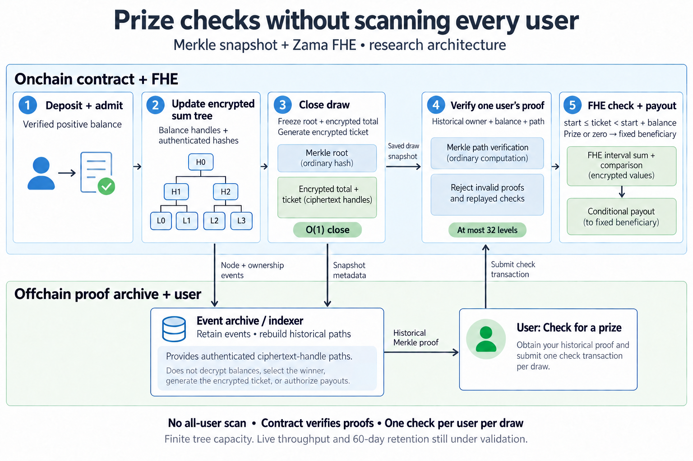

# Taking a confidential prize pool beyond 32 users

Kettigo lets people save money and enter draws weighted by their deposits. The first implementation had a problem: it supported only 32 participants.

That ceiling came from the draw algorithm. Closing a round scanned every participant, accumulated their encrypted balances, checked the winning ticket, and credited winnings using Zama FHE. More participants meant more computation and a longer chain of dependent operations in one transaction. Raising the constant would leave that bottleneck intact.

The experimental replacement uses a **Merkle tree of encrypted balances**. Closing a round freezes its snapshot and generates an encrypted winning ticket. Users then check individually: a Merkle proof authenticates their historical balance and position, and FHE determines whether their ticket interval contains the winner. Any prize goes directly to the authenticated beneficiary.

This removes the all-user scan from closing a draw. Each check follows at most 32 tree levels, regardless of the occupied population. An indexer reconstructs historical proofs; the contract verifies them. The tested tree has a finite capacity of 2^32 slots, with further limits from arithmetic, storage, and network throughput.

Testing covered **4,096 funded local accounts and every account's prize check**, using a simulated FHE backend. A separate **24-hour Sepolia experiment** exercised real FHE with eight wallets across 48 cycles: 1,635 confirmed transactions, zero mined reverts, and successful principal and prize accounting.

The live run also exposed RPC failures, service timeouts, and missing historical logs. Recovery worked from retained events, making durable archival storage a concrete requirement.

The result is a tested research candidate beyond the original 32-user design. Maximum live throughput and real 60-day recovery remain unproven. Production integration is still pending.

Code and evidence: [research contract](https://github.com/vibern0/kettigo/blob/main/packages/contracts/experiments/claim-lab/contracts/ReusableMerkleProbe.sol), [4,096-account validation](https://github.com/vibern0/kettigo/blob/main/packages/contracts/experiments/claim-lab/VALIDATION.md), [Sepolia report](https://github.com/vibern0/kettigo/blob/main/packages/contracts/experiments/claim-lab/SOAK_VALIDATION.md).
